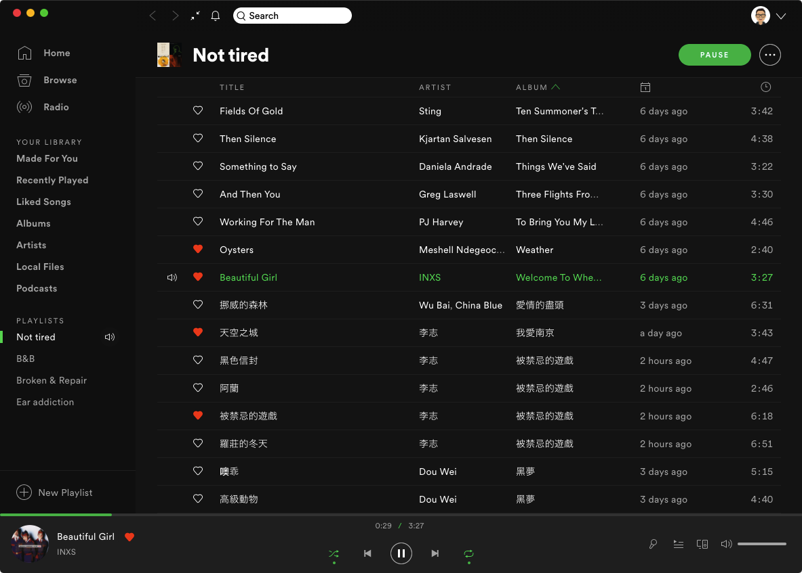
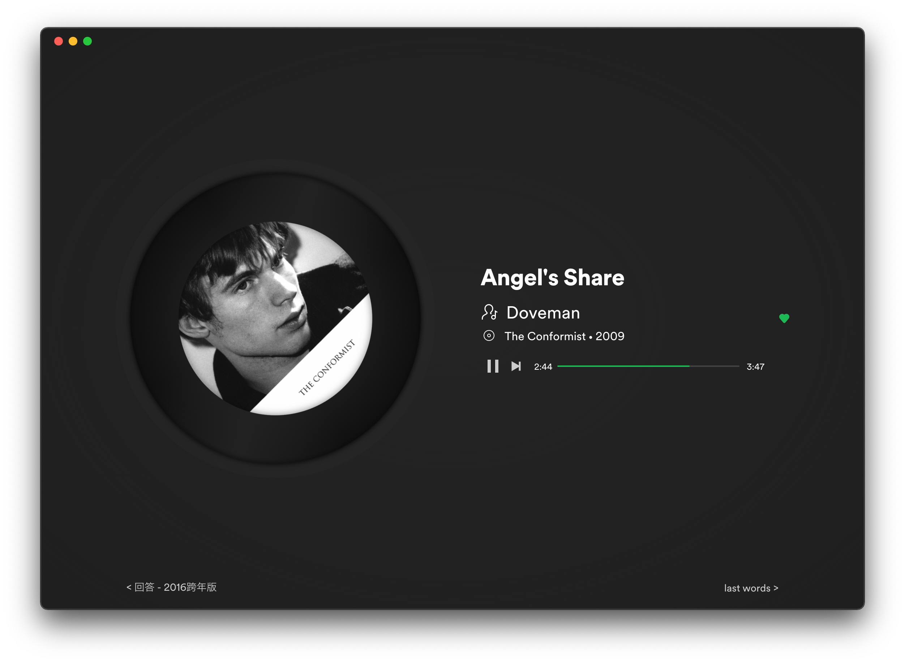
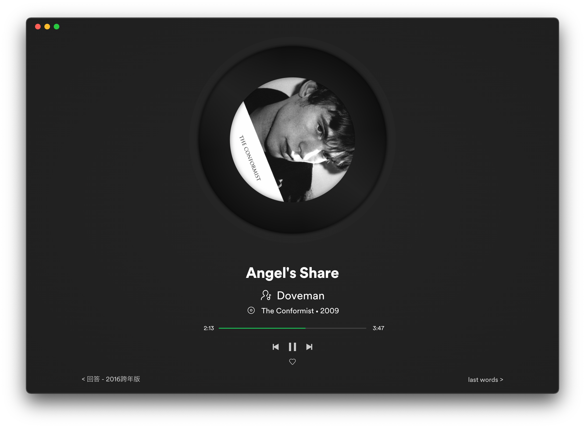

# Turntable

Based on Spotify original theme.

**Compatibility:** The main player has been tested on Windows with Spotify **1.3.6.1921** and Spicetify **2.46.4**.

The seek bar sits above the bottom playback controls, with elapsed and total or remaining time beneath it. Album artwork rotates during playback and pauses with the player. Rotation is disabled when reduced motion is enabled.

View the **CHANGELOG** [here](https://github.com/grasonchan/spotify-spice/blob/master/CHANGELOG.md).

## Screenshots

<div align="center">
  
</div>
<div align="center">
  
</div>
<div align="center">
  
</div>

## More

### About Turntable

Use CSS to achieve, not picture. This means it can be scaled to any size, but make sure the album cover is not blurry.

Actually, the rotation of the turntable was created at spicetify v1, but in some cases, animation is affected by other factors. I think "fullAppDisplay.js high GPU usage" is the reason. Fortunately, it's normal now!

### Info

Designed and developed by [Grason Chan](https://github.com/grasonchan).

The turntable inspired by [Netease Music](https://music.163.com) and [Smartisan OS build-in Music Player](https://www.smartisan.com/os/#/beauty) (not include code).

Develop and test on macOS. If there's any problem, please open issue or PR.

### Installation

1. Optional: add [Full App Display](https://spicetify.app/docs/getting-started/extensions#full-app-display) for the full-screen record view. The bottom player does not require this extension. The full-screen styles target its legacy `#fad-*` layout, not other full-screen extensions.

```shell
spicetify config extensions fullAppDisplay.js
spicetify apply
```

2. put **Turntable** into the **.config/spicetify**

```shell
cd spicetify-themes
cp -r Turntable ~/.config/spicetify/Themes
```

3. select the theme, then apply

```shell
spicetify config current_theme Turntable
spicetify config inject_theme_js 1
spicetify apply
```

### How to Uninstall

1. remove **Turntable** and **rotateTurntable.js**

```shell
rm -r ~/.config/spicetify/Themes/Turntable
```

2. config to spicetify default theme

```shell
spicetify config current_theme SpicetifyDefault
```

3. remove extension - Full App Display

```shell
spicetify config extensions fullAppDisplay.js-
```

4. apply

```shell
spicetify apply
```
